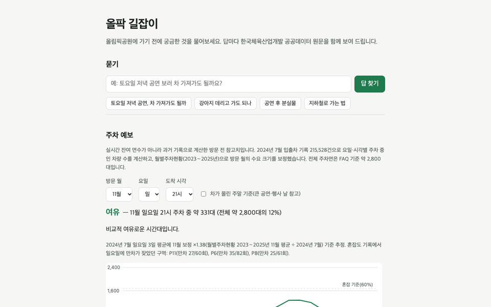
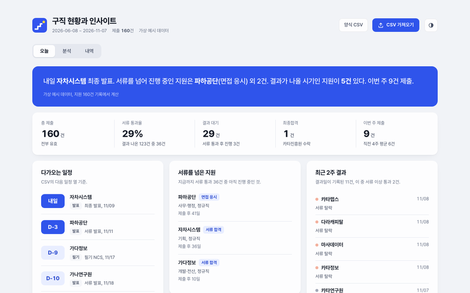
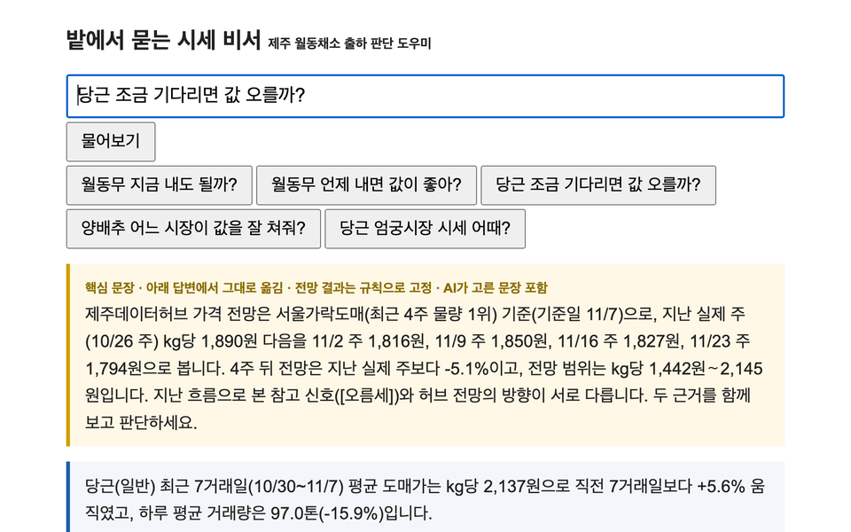
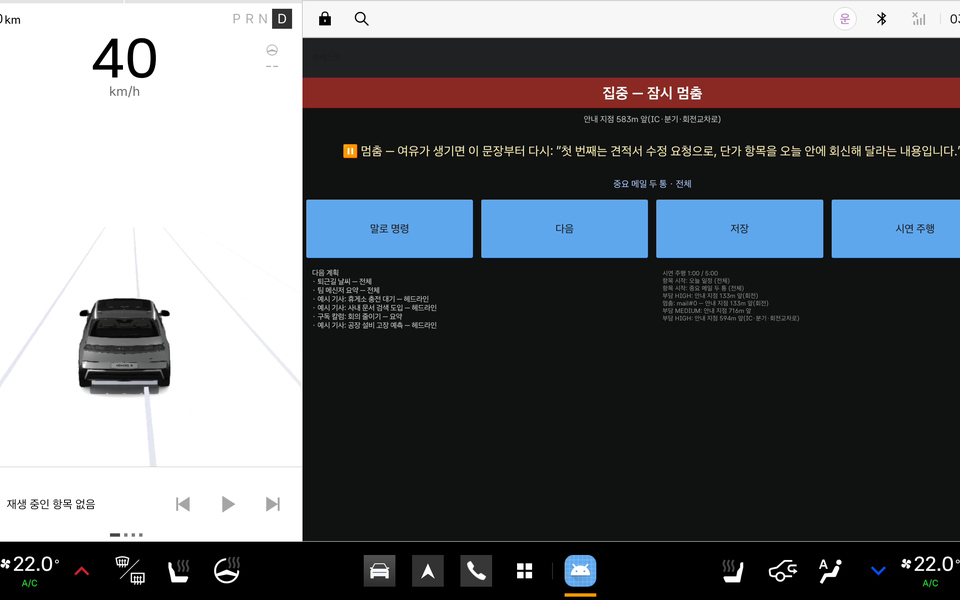

산업 자동화 현장에서 약 3년을 보내고 AI로 넘어왔습니다.
AI에게 일을 맡기는 지금은 맡긴 결과가 맞는지 무엇으로 확인할지를 붙잡고 있습니다.

## 직접 열어 볼 수 있는 것

<table>
<tr>
<td width="50%" valign="top">

<h3>올팍 길잡이</h3>
올림픽공원에 가기 전 궁금한 것을 물으면 한국체육산업개발 공공데이터 FAQ 원문을 근거로 붙여 답합니다. 입출차 기록 215,528건으로 요일별, 시각별 주차 혼잡도를 예보합니다. 서버 없이 브라우저에서 돌아갑니다.
  
<a href="https://sunlitsoil.github.io/olpark-guide/"><b>바로 열기</b></a>&nbsp;&nbsp;&nbsp;<a href="https://github.com/sunlitsoil/olpark-guide">코드</a>
</td>
<td width="50%" valign="top">

<h3>Jobdash</h3>
지원 기록 CSV를 넣으면 이번 주에 챙길 일과 서류가 잘 붙는 곳을 한 화면에 보여 줍니다. 브라우저 안에서만 돌아가고 넣은 데이터는 어디로도 보내지 않습니다. 화면의 회사와 숫자는 지어낸 예시입니다.
  
<a href="https://sunlitsoil.github.io/jobdash/"><b>바로 열기</b></a>&nbsp;&nbsp;&nbsp;<a href="https://github.com/sunlitsoil/jobdash">코드</a>
</td>
</tr>
<tr>
<td width="50%" valign="top">

<h3>밭에서 묻는 시세 비서</h3>
농가가 말로 물은 출하 질문("월동무 지금 내도 될까?")에 제주데이터허브 시세와 가격 전망 숫자를 붙여 답하는 AI Agent입니다. 2026 제주 AI·빅데이터 활용 AI Agent 개발 챌린지 출품작입니다.
  
<a href="https://github.com/sunlitsoil/jeju-harvest-agent#시연"><b>시연 영상</b></a>&nbsp;&nbsp;&nbsp;<a href="https://github.com/sunlitsoil/jeju-harvest-agent">코드</a>
</td>
<td width="50%" valign="top">

<h3>핏캐스트</h3>
도착 시각에 맞춰 끝나고, 운전이 바빠지는 순간에는 스스로 멈추는 차량용 AI 음성 브리핑입니다. Pleos Connect 공모전 출품작의 시제품으로, 에뮬레이터에서 확인했고 실차에서는 아직 돌려 보지 않았습니다.
  
<a href="https://github.com/sunlitsoil/fitcast"><b>코드와 APK</b></a>
</td>
</tr>
</table>

## 팀 프로젝트

| 프로젝트 | 맡은 일 | 결과 |
| :--- | :--- | :--- |
| **공정 도면 심볼 인식** SEMES 기업연계, 2026.04∼05 | AI 파이프라인 전체 심볼 검출, 텍스트 짝짓기, 배관 연결, CAD 원본 추출 | 운영 기본 엔진으로 채택 검출 모델 mAP50 0.986, 재현율 0.988(내부 검증셋) |
| **EyeSpeak** 루게릭병 환자 시선 의사소통, 2026.02∼03 | AI 전부 시선 추적, 메시지 추천, 음성 합성, 모델 학습 | 30fps 실시간 시선 입력 특화 프로젝트 우수상(반 1등) |
| **관상네컷** 얼굴 인식 분석 서비스, 2026.01∼02 | 팀장, React 화면, AI 전체 | 같은 사진 기준 응답 80초에서 40초로 공통 프로젝트 우수상 3등 |
| **AI 직무능력 나침반** 교육기관 검색과 커리어 상담, 2024.06∼08 | React 화면, 후기 감성분석 추천, PDF 기반 RAG 상담 | 제3회 고용노동 공공데이터 활용 공모전 장려상 |

## 혼자 만들어 쓰는 것

| 도구 | 확인한 것 |
| :--- | :--- |
| **노트 검색** 노트를 근거와 함께 찾아 주는 검색, MCP로 에이전트에 연결 | 같은 119개 질문으로 노트 단위 R@10이 78.2%에서 88.2%로 오른 하이브리드 검색을 기본값으로 채택 |
| **개인정보 가림** 외부 AI로 보내기 전에 이름, 기관, 주소를 로컬 모델로 가림 | 같은 22개 사례에서 실제로 가려진 결과 기준 재현율 0.875에서 1.000으로 |
| **채용공고 수집** 39개 경로에서 공고를 모으고 부분 실패를 따로 기록 | 건수만 보면 정상이던 실패를 경로 단위로 드러냄 |
| **24시간 개인 서버** 정기 작업 31개, 결과는 디스코드로, 작업은 Paseo로 이어 감 | 두 번 연속 확인된 장애만 알림 |
| **논문 재현 실험** 12.7B 모델의 어텐션 구조를 약 350만 파라미터로 다시 구현해 12회 학습 | 차이가 시드 편차보다 작아 이 규모에서는 두 구조를 구분할 수 없다고 보고 |

## 같은 조건에서 바꾸기 전과 후

막혔던 지점들

- 도면 인식 모델 네 종을 같은 조건으로 돌려도 차이가 2%p 안이었습니다. 모델보다 데이터 문제로 보고 라벨 점검과 데이터 보강에 시간을 돌렸습니다.
- 개인정보 가림에서 모델은 기관명을 제대로 찾았는데, 괄호가 붙었다는 이유로 후처리 필터가 그 이름을 버리고 있었습니다. 그 뒤로 모델 점수와 실제로 밖에 나가는 결과를 따로 셉니다.
- 논문 재현은 500스텝에서 멈추거나 시드 하나만 봤다면 결론이 달라졌을 실험이었습니다. 우위가 나오지 않은 결과를 그대로 남겼습니다.

## 다뤄 본 기술

Python, PyTorch, YOLO, MediaPipe, 로컬 언어모델(Ollama, MLX), ChromaDB와 BM25, MCP, React, Vue, Django, Ubuntu와 systemd, AWS EC2

---

저장소는 대부분 비공개입니다. 개인 도구의 코드는 AI 코딩 도구의 도움을 받았고, 무엇을 만들지, 어떻게 평가해 무엇을 채택할지는 제가 정했습니다.
